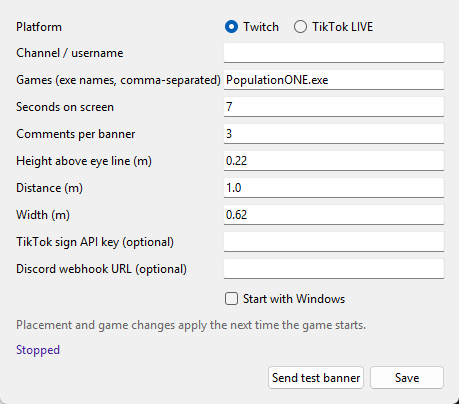
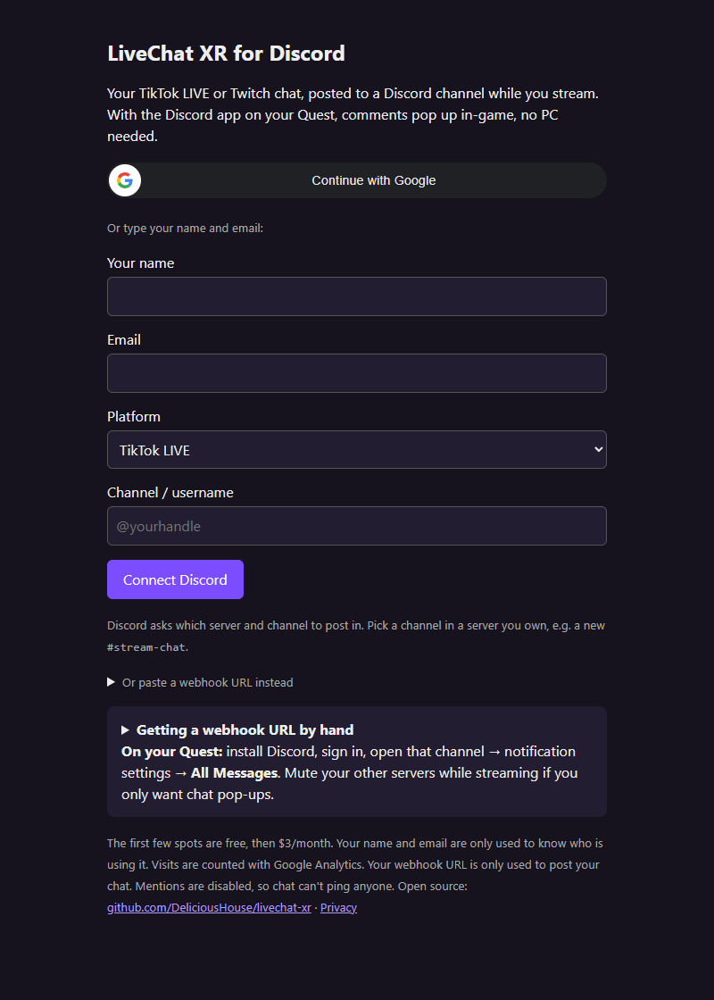

# Get stream chat into your headset

Choose a path, connect your stream, then send a test before going live.

## Choose your path

| You play… | Use… | What you need |
|---|---|---|
| PCVR, with the game running on a Windows PC | [PC overlay](#pc-first-run) | Windows 10/11 x64, an OpenXR game using Direct3D 11, administrator rights to install |
| Quest standalone, with the game running on the headset | [Hosted Discord relay](#quest-first-run) | Quest 2, Quest Pro or Quest 3 series, Discord, a server/channel you control, browser access. No LiveChat XR PC app |

Both accept TikTok LIVE, Twitch and YouTube, in any mix. A Quest connected to a PC by Link/Air Link or Virtual Desktop is PCVR, not standalone. OpenXR is the interface the PC game uses to talk to your headset; this overlay cannot draw in a game using a different interface or D3D12/Vulkan.

**Compatibility checkpoint:** the repo previously recorded the Meta PC version of Population: ONE on Quest 3 via Virtual Desktop as tested. Current docs do not re-certify that setup. The hosted relay posts to Discord; actual notifications over a standalone game and a five-minute setup are not yet verified by newcomer QA. Test on your own headset before relying on it during a stream.

## PC first run

### Step 1: Install the Windows app

Open [GitHub Releases](https://github.com/DeliciousHouse/livechat-xr/releases). Expand **Assets**, download `LiveChatXR-Setup-<version>.exe`, not **Source code**, and run it. Choose a normal release rather than a pre-release unless you want to test it. The installer asks for administrator approval because it registers the VR layer for the machine. Keep the launch option selected at the end.

The installer is not currently code-signed. If Windows warns, first confirm the download came from the DeliciousHouse release page. See [installer troubleshooting](#troubleshooting) rather than disabling protection.

### Step 2: Save your stream settings

On a fresh setup, Settings opens automatically. If it does not, look for the purple chat icon in the Windows notification area (including hidden icons), right-click it, then choose **Settings…**.

Enter your **TikTok handle**, your **Twitch channel**, your **YouTube handle**, or any mix; chat from all of them shows in the same banner. Use your actual account handle, not your display name. In the PC app use the bare handle (TikTok and YouTube also accept a leading `@`; Twitch accepts leading `#`), not a profile URL. YouTube chat comes from your channel's public live page, so it needs no API key or login; Super Chats, stickers and memberships show in gold.

For Population: ONE, leave **Games** as `PopulationONE.exe` if that matches your installed game's process. For another game, open Windows Task Manager while it runs, choose **Details**, and copy the executable name including `.exe`. Separate multiple games with commas. Leave placement and timing at their defaults for your first test. Leave both optional private fields empty for overlay-only use. Select **Start with Windows** if desired, then **Save**.

### Step 3: See a test banner

Start your PCVR game. Right-click the tray icon and choose **Send test banner**. You should see “LiveChat XR: test banner” near the top of your view for about seven seconds. This test does not need TikTok to be live. If it does not appear, use the checks below before proceeding.

Next, go live on your chosen platform and have someone else post a comment. Your own normal comments are skipped. New comments share one banner; gifts/support are gold. More than three selected lines become a `+N more` summary, and long text can be clipped. This is a quick glance at chat, not a full chat log.

**Show LiveChat XR tag** is on by default (`[chat] show_tag = true` in `config.ini`). Each connection shows `LiveChat XR - livechat.deliciouswines.org` through the normal fading banner. TikTok follow asks end with `  - LiveChat XR`; gifts and comments are unchanged. Uncheck it in Settings and Save to disable both banner tags.

**Platform emoji on each message** is on by default (`[chat] platform_icons = true`). Each chat line, in the banner and in Discord, starts with 🎵 for TikTok, 🟣 for Twitch or ▶️ for YouTube. Uncheck it in Settings and Save to turn it off. Hosted relay users have the same checkbox on their manage page.

**Live viewer count (top-right corner)** is on by default in the PC app (`[chat] viewer_count = true`). While any of your channels is live, a small box stays in the top-right of your view: `16 watching`, then each live platform's logo (TikTok note, Twitch bubble, YouTube play button) with its count. The box is only as wide as its text. Counts refresh every 30 seconds for Twitch and YouTube; TikTok sends its own updates. A platform that is offline, or whose count can't be read, is left out; with nothing live the box is hidden. Move or resize it with `[viewers] up`, `right` (the box's right edge), `distance` and `width` in metres; like the banner, placement applies the next time the game starts. Not available on the hosted Discord relay.

### What you set up

The app reads stream chat; the VR layer draws it inside the chosen PC game. Restart the game after changing Games, placement or duration. Keep the tray app running. **Quit** stops new chat updates. To remove the layer, uninstall LiveChat XR through Windows Apps. Only use it with games that permit third-party OpenXR overlays; anti-cheat compatibility is not guaranteed.

## Quest first run

### Step 1: Install Discord on the headset

On Quest, open **Meta Horizon Store**, search for **Discord**, select **Install** or **Get**, then open it and sign in to your Discord account. You do not need a new account or the Windows installer. Discord's [official Quest announcement](https://discord.com/blog/discord-is-now-on-meta-quest-reach-out-to-your-servers-while-in-vr) links its setup FAQ; the [store page](https://www.meta.com/experiences/discord/25956082250713643/) lists availability. If the app is unavailable for your device/account, use Meta support rather than an unofficial APK.

Use a private Discord server and a text channel such as `stream-chat`. If you are new to Discord, its add-server **+** menu lets you create your own server. Use the same account on the headset and on the browser/phone where you do setup. Enable notifications for that channel, choose **All Messages**, and ensure the channel/server is not muted.

### Step 2: Connect your channel

Open [LiveChat XR](https://livechat.deliciouswines.org/) in your browser. Enter your TikTok handle, your Twitch channel, your YouTube handle, or any mix: chat from all of them lands in the same Discord channel. Here, unlike the PC app, a full TikTok/Twitch/YouTube profile URL is also accepted (a `/live` URL works too, and `https://` is optional); leading `@` is optional. YouTube watch, live, shorts, `youtu.be`, `music.youtube.com`, `/channel/UC…`, `/c/` and `/user/` links resolve to the owning channel's @handle when you save. `youtu.be` and `music.youtube.com` are additional accepted hosts; lookalike hosts are rejected. Resolution depends on YouTube exposing the owner/handle in its pages; unavailable videos, lookup failures and handles outside the supported letters/digits/underscore/dot/hyphen format cannot be resolved. If a link fails, paste your @handle instead.

Press **Log in or sign up with Discord**. In Discord's authorization screen, pick the server and text channel you control and approve. That one approval tells LiveChat XR who you are (your Discord user ID, username and email if Discord shares a verified one) and creates the webhook it posts to, so there is no form to fill in and nothing to copy. Finish in the same browser you started in: if Discord opens its own browser (common on Quest and phones), the relay asks you to start again in your original browser. A self-hosted relay without Discord sign-in configured instead shows **Name**, **Email**, **Discord webhook URL** and **Connect**; use the [webhook steps below](#how-to-make-a-discord-webhook) there.

You land on your private manage page. Keep its link private and bookmark it; it is also posted to the chosen Discord channel. Every registration starts listening immediately. In donation mode, all saved channels run free; a donation is optional and does not activate channels. Self-hosted servers without donation mode can limit free registrations to one channel; see [pricing](#pricing-and-billing). A signup confirmation is not proof that your stream or headset is connected.

### Step 3: Test before streaming

On your manage page choose **Send test message**. Check the message appears in the selected Discord channel, then check notifications on Quest, then test again with the standalone game open. No payment is needed in donation mode. “Test sent” on the webpage does not prove delivery. If you see the channel message but no in-game notification, use troubleshooting; do not assume the game supports it.

After that, go live and ask another person to comment. Keep the registration active; the hosted server listens again when you go live. You do not need to leave the browser open or run a PC app. Avoid also connecting the same Discord webhook in the Windows app: that can duplicate posts.

### What you set up

Your stream chat goes to a Discord channel. Discord and the Quest notification system handle display; LiveChat XR does not install an overlay into the standalone game. Use **Stop and delete** to remove the relay connection when no longer needed. Paid billing is cancelled separately below.

## How to make a Discord webhook

After a TikTok connection ends, the PC app saves a short session summary; with a Discord webhook configured it also posts that summary and shows it once as a banner. The hosted relay posts a summary when TikTok or YouTube reports going offline, including observed comments, distinct chatters and gift/support events, plus TikTok peak viewers and new follows when available. Unknown fields are omitted; these are connection-local observations, not the platform's full analytics. Twitch IRC provides no stream-end signal, so Twitch end summaries are not available. This summary is included without a new paid gate; relay totals are stored privately in `sessions.jsonl`, without chat text or chatter identities.

A webhook is a private address that lets LiveChat XR post messages to one Discord channel. It is not your Discord password, a server invite or a channel link. Anyone with the address can post there, so treat it like a password.

1. In Discord desktop or web, open a server you own and make a text channel for stream chat. Phone apps may not expose webhook administration; use Discord web/desktop if the option is missing.
2. Open that channel's settings (gear), then **Integrations → Webhooks → New Webhook**. Alternatively, use **Server Settings → Integrations → Create Webhook**, then select the intended text channel.
3. Name it **LiveChat XR**, choose the right channel, and press **Copy Webhook URL**. Paste directly into the relay form or optional PC Settings field. Do not put it in a screenshot, public post or support issue. Do not append `/github`.
4. Save/connect, then send a test from the app or private manage page. Confirm the actual channel received it.

If you cannot create a webhook, check that you own the server or have its **Manage Webhooks** permission. On the hosted relay, **Log in or sign up with Discord** creates the webhook for you. Discord's [webhook guide](https://support.discord.com/hc/en-us/articles/228383668-Intro-to-Webhooks) contains screenshots of its own settings; menus may change. LiveChat XR disables mentions so viewer text cannot ping everyone or roles.

## How to correct a stream name

Use the exact TikTok username on your profile, not the nickname shown on screen. You do not have to be live just to sign up. If the server says it cannot find your account, check spelling and LIVE eligibility. If it cannot verify TikTok right now, signup can still succeed with a note; confirm the status later.

On the hosted relay, open your private manage link and use **Edit settings → Save settings**. Change your name, email (optional for Discord sign-ups) or stream channels there. Leave the webhook blank to keep it; paste a new Discord webhook if you deleted the old channel/webhook. Both are revalidated. Your private link, creation date, subscription and founder/paid plan stay unchanged; the relay restarts and posts confirmation to the new webhook. Changing your Discord username needs no action. In the PC app, change Channel in Settings and save.

**Lost your link?** Select **Already set up? Log in** on the setup page (or press **Log in or sign up with Discord** with the channel fields empty) and approve with the Discord account you signed up with. Log-in creates no webhook. If that account has more than one relay, choose its channel list. One Discord account can have up to 3 relays; signing up the same stream again moves that relay to the channel you pick instead of adding a second one. The manage link is also in the original post in your Discord channel. There is no recovery email sender.

**Signed up before Discord sign-in?** Your relay and manage link keep working. To link it to your Discord account, press **Log in or sign up with Discord** with the same stream channel and pick a channel in the same Discord server: the existing relay moves there with its plan and link unchanged, and you can log in with Discord from then on. A paid account is linked the same way; don't delete it first.

Twitch and YouTube retain permanent channel IDs and automatically follow renamed handles, with one Discord confirmation. Twitch needs relay-side Helix credentials; without them, it keeps anonymous IRC and checks the saved room ID. TikTok IDs are saved when its public profile or room info exposes them, but there is no supported ID-to-handle lookup. After three consecutive not-found checks on a previously resolved TikTok/Twitch account, the status says **Handle not found: did you rename?** and Discord gets one manage-link alert per handle change. Edit the handle to recover.

**Channel status** distinguishes waiting/offline, connected with no messages yet, last successful chat delivery, missing channels, platform rate limiting, Discord webhook rejection and channels waiting for upgrade. **Send test message** checks Discord separately. **Something's wrong** saves plan, channel names, normalized error categories, last successful delivery times, relay version and uptime to a bounded server-side support log. No webhook, manage token, email or chat content is included; this is not a chatbot or an instant support response.

## Pricing and billing

With donation mode enabled (`DONATE_URL` set), the relay is free for every streamer and runs all your saved channels; it asks for [donations](https://buy.stripe.com/8x200kaXv3rQ5XmcV90x203) instead of charging. Donations are optional and do not change your plan. Anyone who subscribed earlier keeps that subscription until they cancel it (see below). The service still has a total capacity limit and can say it is full.

Self-hosted servers without `DONATE_URL` retain priced mode: the first 5 registrations are lifetime founders with all channels free; later free registrations run the first filled channel (TikTok, then Twitch, then YouTube). Extra channels are saved and marked **waiting for upgrade**; paid users run all saved channels ($3 per month or $25 per year). Founder slots are per registration/webhook; updating the same webhook keeps that plan, and deleting a founder does not reopen a slot.

Free and founder relay registrations append `via LiveChat XR - livechat.deliciouswines.org` as one extra line on the first chat batch after a source connects, including reconnects. Later batches are unchanged; paid registrations have no tag. No extra Discord post is sent just for the tag.

Only in priced mode, use a plan link **on your private manage page** to run extra channels so Stripe can match payment to that connection. Once Stripe reports a paid checkout, all saved channels start without re-registration. Refresh the page after payment; do not pay again merely because activation is delayed. Payment is handled by Stripe; LiveChat XR keeps the subscription ID, not card details. The open-source PC app stays ungated.

### How to cancel

On a paid registration's manage page, select **Manage billing or cancel**. Sign in to Stripe's portal using the email used at checkout and follow its cancellation steps. Check the portal's confirmation and effective end date. When Stripe reports the subscription ended, all saved channels keep running free in donation mode; only in priced mode does the first channel remain free with extra channels saved, waiting for upgrade. Founders are never downgraded. If the link is missing or the page is gone, use the billing link in your Stripe receipt or contact support without posting private links. **Stop and delete only stops chat and deletes registration; it does not cancel billing.** Cancel billing first, then use Stop and delete if you also want your data removed.

### Privacy

Read the hosted [Privacy page](https://livechat.deliciouswines.org/privacy). The relay stores name/email, stream channel, webhook, subscription ID when paid and delivery/failure counts. It passes chat to Discord rather than keeping a chat archive. Public pages may use Google Analytics when configured. Deletion removes the registration immediately; the published policy says backup copies roll off within 90 days. Discord and Stripe have their own policies. The PC app writes the latest banner locally and may log connection information; keep its config and logs private.

## Troubleshooting

| Problem | Try this |
|---|---|
| Wrong TikTok name / cannot find account | Copy the actual handle, not nickname. Correct it as above. The relay retries every minute, so a first stream is picked up within a minute. Capital letters don't matter. LIVE permission can also be the cause |
| Not live yet / waiting | That is normal. Go live on TikTok, then have another person comment. Twitch may connect before any comments arrive |
| Stream connected but no chat | Your own normal comments are skipped. Wait a batch window (seven seconds by default), use another viewer, check selected channel and payment status |
| No Discord message | Confirm the webhook points to the right text channel and has not been deleted. Send a manage/app test and look in the actual channel. Chat retries temporary Discord failures automatically; the account status shows delivered, queued and collapsed messages. Only unsent backlog older than 60 seconds is collapsed |
| I can't see any chat in Discord | On your manage page choose **Open this channel in Discord**; that is exactly where chat posts. If it opens a channel you don't recognize, you picked a different channel (a voice channel's chat is easy to pick by mistake) or you are signed in to another Discord account. Signing up again in the same Discord server replaces your earlier relay instead of adding a second one |
| Discord channel gets messages, Quest has no pop-ups | Open Discord on Quest, confirm the same account/channel, unmute channel/server, use All Messages, allow headset notifications and turn off Do Not Disturb if enabled. Test outside the game, then inside it. Report the device/software/game combination if only in-game delivery fails; this path is not certified for every game |
| SmartScreen warns on installer | The installer is not code-signed, so this warning is expected. Verify it first: `gh attestation verify LiveChatXR-Setup-<version>.exe -R DeliciousHouse/livechat-xr` must pass ([how](deployment.md#verify-a-release-download)). The build attestation proves the file came from this repository's release workflow; it does not remove the warning. If it passes, Windows may offer More info → Run anyway. Cancel if the origin or integrity is uncertain |
| Antivirus quarantines installer/app | Do not disable antivirus or add blanket exclusions. Check the release source/integrity, inspect the detection and report it with product/version/detection name, not private logs. Wait for a reviewed fix if uncertain |
| Pop1 has no banner / no new overlay.log | Confirm you launched the PC version, its exact executable is in Games, and the session uses OpenXR. Save settings, restart game, then Send test banner. A standalone Quest game cannot load the Windows layer |
| overlay.log says DISABLED: not a D3D11 session | That graphics mode is unsupported. Do not assume changing a setting makes a D3D12/Vulkan-only game supported |
| overlay.log says session ready, still no banner | Send a fresh test after game start (old banner files expire). Check tray status, app.log and placement. Restart after placement/duration changes; include sanitized log lines when reporting |
| TikTok retrying / rate limited | Unofficial TikTok access can change or fail. Check the account is live and wait for retries. Optional signing-key support exists in PC Settings; consult the provider's current terms, not a promise of free/unlimited access |
| Discord sign-in cancelled / expired / "finished in a different browser" | Press **Log in or sign up with Discord** again and finish in the same browser. Discord sign-in expires after 15 minutes and works once |
| Lost manage link | **Already set up? Log in** with Discord, or find the original message in your private Discord channel. Never post the link publicly |

PC logs: tray **Open data folder**, then `app.log` and `overlay.log`. For support, [open a GitHub issue](https://github.com/DeliciousHouse/livechat-xr/issues) with app version, PC/standalone path, headset/game/runtime, observed status and the step that failed. Omit email addresses, webhook URLs, manage links, keys and viewer messages. You can disable the PC layer with `LIVECHATXR_DISABLE=1` in the game's environment before starting it, or uninstall.

## FAQ

**Do I need a PC for Quest standalone?** No LiveChat XR PC app is needed. The hosted relay reads chat; install Discord from Meta Horizon Store and verify notifications on your headset.

**Can I use Twitch or YouTube instead of TikTok?** Yes. Enter the Twitch channel or YouTube handle on signup or in PC Settings. Twitch signup checks the name's format, not whether the account exists; YouTube signup checks that the channel page exists. YouTube chat is read only while your channel is live and starts from the moment you connect (old messages are not replayed).

**What does Log in or sign up with Discord authorize?** Sign-up asks for `identify`, `email` and `webhook.incoming`: your Discord user ID and username, your email, and a webhook in the server/channel you pick so the relay can post there. Log-in asks only for `identify`. Use a private channel you control: the manage link is posted there, and anyone who can read the channel can use it (an accepted owner decision; see [architecture](architecture.md#identity-and-payment)). LiveChat XR never sees your Discord password.

**Will every message show?** No. Chat is batched, overflow is summarized and failed Discord posts are not replayed. Gift lines are prioritized, but more gifts than the line limit also overflow.

**Can I cancel?** Yes, through Stripe's billing portal. Deleting the relay connection alone does not cancel payment.

**Can viewers ping my server?** LiveChat XR disables Discord mentions in its posts and suppresses link previews, so a link typed in chat never unfolds into a preview card or image. Keep the webhook itself private because someone using it directly is outside LiveChat XR's controls.

**Does it store my chat?** The hosted relay passes it to Discord and keeps delivery counters, not a chat archive. Discord retains messages under its policies; the PC app keeps the latest banner file.

**Does it work in every VR game?** No. PC needs OpenXR/D3D11 and an allowed third-party layer. Standalone notification behavior depends on Discord/Quest/game settings and must be tested. There is no guaranteed five-minute or universal-headset claim.

For technical details see [reference](reference.md), [architecture](architecture.md) and [operations](operations.md).
